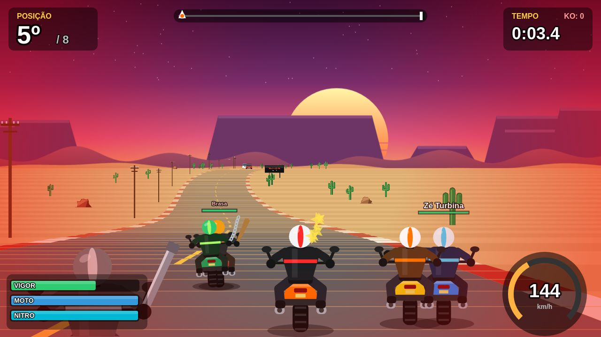
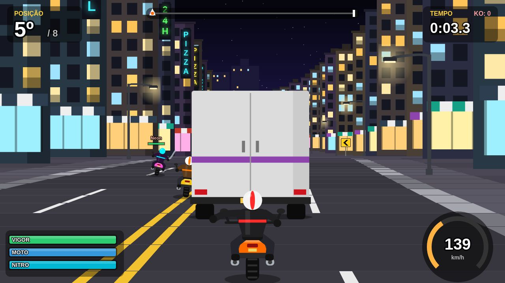
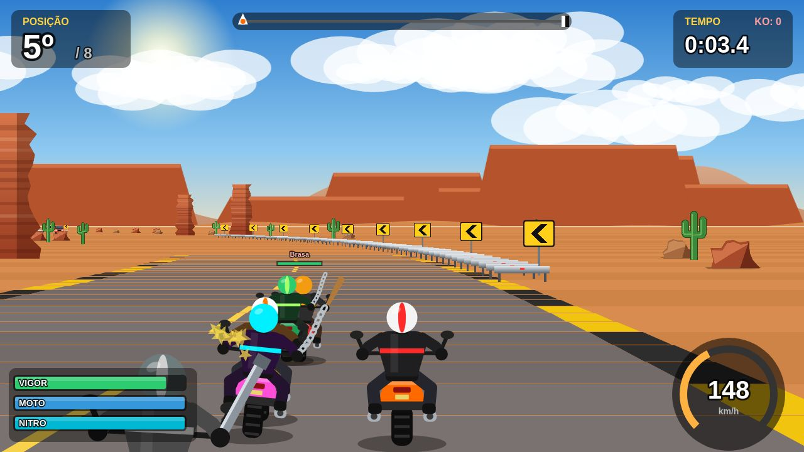
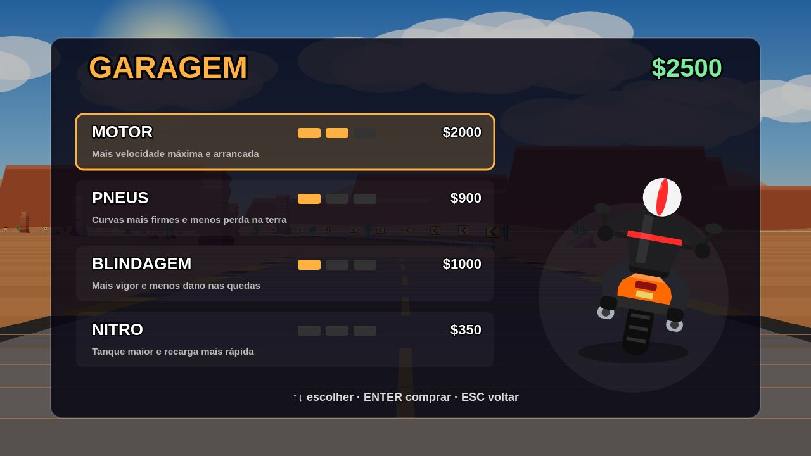
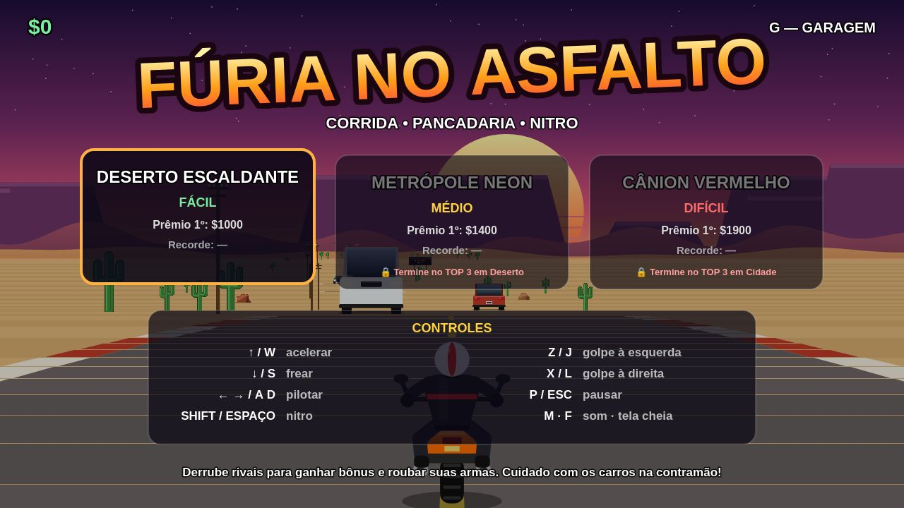

# 🏍️ Fúria no Asfalto

**Corrida de combate em motos, em estilo arcade.** Acelere pelo deserto, pela cidade e pelo cânion, derrube os rivais na porrada, roube as armas deles e chegue em primeiro.

O jogo inteiro roda num único arquivo HTML: sem instalação, sem dependências e sem assets externos. Gráficos, fundos, efeitos sonoros e trilha são gerados por código.



<p align="center">
  
  
</p>

---

## ▶️ Como jogar

Abra o `index.html` em qualquer navegador moderno. Para servir a pasta localmente:

```bash
python3 -m http.server 8000
# acesse http://localhost:8000
```

> Num Codespace, abra a porta 8000 pela aba **Portas**.

---

## 🎮 Controles

| Ação | Teclado | Gamepad |
|---|---|---|
| Acelerar | `↑` / `W` | RT / A |
| Frear | `↓` / `S` | LT / ↓ |
| Pilotar | `←` `→` / `A` `D` | Analógico / direcional |
| Golpe à esquerda | `Z` / `J` | X / LB |
| Golpe à direita | `X` / `L` | B / RB |
| Nitro | `Shift` / `Espaço` | Y |
| Pausar | `P` / `Esc` | Start |
| Abandonar a corrida (no pause) | `Q` | Select |
| Garagem (no menu) | `G` | Select |
| Som / tela cheia | `M` / `F` | — |

No **celular**, os botões aparecem automaticamente na tela.

---

## 🗺️ Pistas

| Pista | Dificuldade | Ambiente | Prêmio do 1º |
|---|---|---|---|
| **Deserto Escaldante** | Fácil | Pôr do sol, cactos e mesas; estrada de mão dupla | $1000 |
| **Metrópole Neon** | Médio | Cidade à noite, letreiros neon e 4 faixas com trânsito pesado | $1400 |
| **Cânion Vermelho** | Difícil | Curvas fechadas, morros e guard-rails | $1900 |

Termine no **TOP 3** de uma pista para liberar a próxima.

---

## 👊 Combate

- **Soco e chute** para os dois lados. A cada três golpes sem arma, um é chute, que empurra mais o rival para o lado.
- Os rivais **preparam o golpe** antes de bater. Se você se afastar a tempo, o golpe erra.
- Derrube um rival armado e **a arma passa a ser sua**:

| Arma | Dano | Alcance |
|---|---|---|
| Taco | ●●●○ | ●●○○ |
| Corrente | ●●○○ | ●●●● |
| Cano | ●●●● | ●○○○ |

- Cada nocaute vale **+$150**. Se você cair, perde a arma.

### Os rivais

| Piloto | Estilo |
|---|---|
| **Dona Faísca** | A mais rápida do grid; quase não briga |
| **Neon** | Veloz e armada com corrente |
| **Brasa** | Equilibrada, anda com taco |
| **Zé Turbina** | Rápido e pouco agressivo |
| **Cobra** | Muito agressiva, com corrente |
| **Lobo** | O mais violento, com taco |
| **Tatu** | Lento, mas carrega um cano |

---

## ⚠️ Perigos

- **VIGOR**: cai a cada golpe que você leva. Se zerar, você vai ao chão.
- **MOTO**: sofre dano a cada queda. Se zerar, a moto é destruída e a corrida acaba.
- **Carros**: bater na traseira em alta velocidade derruba você. Na **contramão**, qualquer batida derruba.
- **Fora da pista**: você perde velocidade, e placas, postes, pedras e prédios derrubam na hora.
- **Rivais caídos** no meio da pista fazem você perder velocidade.

---

## 🔧 Garagem



Use o dinheiro dos prêmios para comprar melhorias. Cada uma tem 3 níveis:

- **Motor**: velocidade máxima e arrancada
- **Pneus**: aderência nas curvas e menos perda fora do asfalto
- **Blindagem**: mais vigor e menos dano nas quedas
- **Nitro**: tanque maior e recarga mais rápida

O progresso (dinheiro, melhorias, pistas liberadas e recordes) fica salvo no navegador.

<br clear="right">

---

## 💡 Dicas

- Guarde o nitro para as retas. Usado em curva fechada, ele joga você para fora da pista.
- Solte o acelerador antes das curvas marcadas com placas amarelas.
- No deserto e no cânion, prefira a faixa da direita: a da esquerda é contramão.
- Pegue logo uma arma derrubando Brasa, Lobo, Cobra, Neon ou Tatu.
- O Cânion Vermelho é bem mais fácil com motor e pneus melhorados.

---

## 🛠️ Para desenvolvedores

- **Tecnologia**: HTML5 Canvas 2D e WebAudio, em JavaScript puro, sem build.
- **Renderização**: pseudo-3D por projeção de segmentos de pista, com fundos em parallax, neblina e clipping de sprites por relevo.
- **Estrutura**: está tudo no `index.html`. O mapa detalhado do código, os valores de equilíbrio e o jeito de testar estão em [`AGENTS.md`](AGENTS.md).
- **Validação rápida** (checa a sintaxe do script):
  ```bash
  sed -n '/<script>/,/<\/script>/p' index.html | sed '1d;$d' > /tmp/game.js && node --check /tmp/game.js
  ```

<p align="center"></p>
